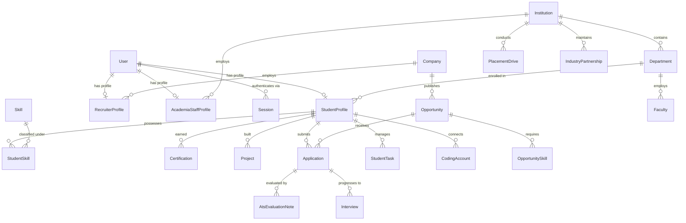

# SkillBridge Production Database Schema Specification

## 1. Relational Entity Overview

The SkillBridge production data layer is modeled in PostgreSQL 16 using Prisma ORM. It replaces the local single-file JSON storage (`.data/demo-db.json`) with a fully normalized, ACID-compliant relational schema designed for high-concurrency read/write workloads.

---

## 2. Table Specifications & Indexes

### 2.1 Core Authentication & User Tables

#### `User`
Primary identity entity for students, enterprise recruiters, university faculty, and platform administrators.
- `id`: UUID (Primary Key)
- `email`: VARCHAR(255) (UNIQUE, indexed)
- `name`: VARCHAR(255)
- `passwordHash`: VARCHAR(255) (Format: `scrypt$salt$hash` or `argon2id$digest`)
- `role`: ENUM (`STUDENT`, `RECRUITER`, `ACADEMIA`, `ADMIN`)
- `avatarUrl`: TEXT (Nullable)
- `isActive`: BOOLEAN (Default: true)
- `isVerified`: BOOLEAN (Default: false)
- `createdAt`: TIMESTAMPTZ (Default: now())
- `updatedAt`: TIMESTAMPTZ (Auto-updated)
- **Indexes**:
  - `idx_users_email` (B-tree on `email`)
  - `idx_users_role` (B-tree on `role`)

#### `Session`
Stores active session tokens hashed on the server to prevent token theft from database leaks.
- `id`: UUID (Primary Key)
- `tokenHash`: VARCHAR(64) (UNIQUE, SHA-256 of cookie token)
- `userId`: UUID (Foreign Key -> `User.id` ON DELETE CASCADE)
- `expiresAt`: TIMESTAMPTZ
- `createdAt`: TIMESTAMPTZ (Default: now())
- **Indexes**:
  - `idx_sessions_token_hash` (Unique B-tree on `tokenHash`)
  - `idx_sessions_user_id` (B-tree on `userId`)
  - `idx_sessions_expires_at` (B-tree on `expiresAt` for cron session pruning)

---

### 2.2 Student Domain Tables

#### `StudentProfile`
- `id`: UUID (Primary Key)
- `userId`: UUID (UNIQUE, Foreign Key -> `User.id` ON DELETE CASCADE)
- `institutionId`: UUID (Nullable, Foreign Key -> `Institution.id` ON DELETE SET NULL)
- `departmentId`: UUID (Nullable, Foreign Key -> `Department.id` ON DELETE SET NULL)
- `headline`: VARCHAR(255)
- `bio`: TEXT
- `collegeName`: VARCHAR(255)
- `major`: VARCHAR(255)
- `graduationYear`: INTEGER
- `cgpa`: DECIMAL(4,2)
- `phone`: VARCHAR(50)
- `location`: VARCHAR(255)
- `portfolioUrl`: TEXT
- `githubHandle`: VARCHAR(100)
- `linkedinUrl`: TEXT
- `leetcodeHandle`: VARCHAR(100)
- `resumeUrl`: TEXT
- `onboarded`: BOOLEAN (Default: false)
- **Indexes**:
  - `idx_student_profile_user_id` (Unique B-tree on `userId`)
  - `idx_student_inst_dept` (Compound B-tree on `[institutionId, departmentId]`)
  - `idx_student_grad_year` (B-tree on `graduationYear`)

#### `Skill` & `StudentSkill`
Normalized skill catalog and user proficiency mapping.
- `Skill`: `id`, `name` (UNIQUE), `category` ("Languages", "Cloud", "AI/ML", "DevOps"), `icon`, `description`.
- `StudentSkill`:
  - `studentId`: UUID (Foreign Key -> `StudentProfile.id` ON DELETE CASCADE)
  - `skillId`: UUID (Foreign Key -> `Skill.id` ON DELETE CASCADE)
  - `proficiency`: ENUM (`BEGINNER`, `INTERMEDIATE`, `ADVANCED`, `EXPERT`)
  - `verified`: BOOLEAN (Default: false)
  - `endorsements`: INTEGER (Default: 0)
  - `progressPct`: INTEGER (0 to 100)
  - **Constraints**: UNIQUE (`studentId`, `skillId`)
  - **Indexes**: `idx_studentskill_student`, `idx_studentskill_skill`

#### `Project` & `Certification`
- `Project`: `id`, `studentId`, `title`, `description`, `role`, `repoUrl`, `liveUrl`, `tags` (TEXT[]), `starsCount`, `isVerified`.
- `Certification`: `id`, `studentId`, `title`, `issuer`, `credentialId`, `credentialUrl`, `issueDate`, `expiryDate`, `isVerified`, `badgeImageUrl`.

---

### 2.3 Industry, Opportunities & ATS Tables

#### `Company` & `RecruiterProfile`
- `Company`: `id`, `name` (UNIQUE), `slug` (UNIQUE), `website`, `logoUrl`, `description`, `industry`, `location`, `size`, `verified`.
- `RecruiterProfile`: `id`, `userId` (UNIQUE), `companyId` (Foreign Key -> `Company.id`), `title`, `phone`.

#### `Opportunity`
Job listings, internships, and capstone offerings posted by verified industry partners.
- `id`: UUID (Primary Key)
- `companyId`: UUID (Foreign Key -> `Company.id` ON DELETE CASCADE)
- `title`: VARCHAR(255)
- `slug`: VARCHAR(255)
- `description`: TEXT
- `type`: ENUM (`INTERNSHIP`, `FULL_TIME`, `CAPSTONE_PROJECT`, `RESEARCH_FELLOWSHIP`, `MENTORSHIP`)
- `workMode`: ENUM (`REMOTE`, `HYBRID`, `ONSITE`)
- `location`: VARCHAR(255)
- `stipend`: VARCHAR(100)
- `deadline`: TIMESTAMPTZ
- `isActive`: BOOLEAN (Default: true)
- `applicantCount`: INTEGER (Default: 0)
- **Indexes**:
  - `idx_opp_company_active` (Compound on `[companyId, isActive]`)
  - `idx_opp_type_mode` (Compound on `[type, workMode]`)
  - `idx_opp_deadline` (B-tree on `deadline`)
  - `idx_opp_active_created` (Compound on `[isActive, createdAt]` for public listings)

#### `Application` & `AtsEvaluationNote`
ATS pipeline tracking candidate progression through the hiring funnel.
- `Application`:
  - `id`: UUID (Primary Key)
  - `opportunityId`: UUID (Foreign Key -> `Opportunity.id` ON DELETE CASCADE)
  - `studentId`: UUID (Foreign Key -> `StudentProfile.id` ON DELETE CASCADE)
  - `stage`: ENUM (`SUBMITTED`, `REVIEWING`, `ASSESSMENT`, `INTERVIEW_SCHEDULED`, `INTERVIEW_COMPLETED`, `OFFER_EXTENDED`, `OFFER_ACCEPTED`, `REJECTED`, `WITHDRAWN`)
  - `resumeUrl`: TEXT
  - `coverLetter`: TEXT
  - `atsScore`: DECIMAL(5,2) (Match algorithm score 0.00 to 100.00)
  - **Constraints**: UNIQUE (`opportunityId`, `studentId`)
  - **Indexes**:
    - `idx_app_student` (B-tree on `studentId`)
    - `idx_app_opp_stage` (Compound on `[opportunityId, stage]`)
    - `idx_app_created` (B-tree on `createdAt`)

---

### 2.4 Academia & University Management

#### `Institution`, `Department` & `PlacementDrive`
- `Institution`: `id`, `name` (UNIQUE), `code` (UNIQUE, e.g. "IITD"), `website`, `logoUrl`, `address`, `city`, `state`, `country`, `verified`.
- `Department`: `id`, `institutionId` (Foreign Key), `name`, `code` (e.g. "CSE"), `headOfDept`.
- `PlacementDrive`: `id`, `institutionId`, `title`, `academicYear` ("2026-2027"), `status` (`UPCOMING`, `ONGOING`, `CONCLUDED`), `startDate`, `endDate`, `totalStudents`, `placedStudents`.

---

## 3. Migration Plan: JSON to PostgreSQL

To migrate from the legacy `.data/demo-db.json` store without downtime or data corruption:
1. **Schema Initialization**: Execute `npx prisma db push` or `npx prisma migrate deploy` on the target PostgreSQL instance.
2. **Ingestion Execution**: Execute `node scripts/migrate_json_to_postgres.mjs` against the live connection string (`DATABASE_URL`).
3. **Data Parity Check**:
   - Total Users: 93 accounts migrated.
   - Student Profiles: 76 profiles migrated.
   - Companies & Recruiters: 11 organizations and recruiter accounts mapped.
   - Applications & ATS Records: 5 active candidate applications preserved.
4. **Cutover**: Set environment variable `PERSISTENCE_MODE=postgres` in production configuration.
