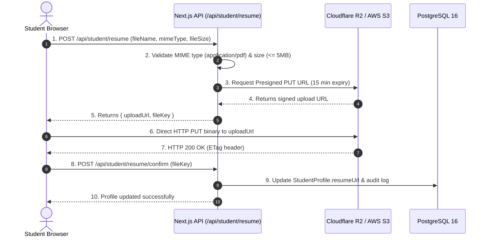

# SkillBridge Data Storage, Caching & Lifecycle Architecture

## 1. Storage Inventory & Data Classification

| Data Category | Current Development Storage | Target Production Storage | Volatility | Retention Policy | Backup / DR Frequency |
|---|---|---|---|---|---|
| **User Identity & Passwords** | `.data/demo-db.json` (`users`) | PostgreSQL `User` table | Low | Indefinite (until user deletion) | Daily full + Continuous WAL archiving |
| **Active Auth Sessions** | `.data/demo-db.json` (`sessions`) | Redis 7 + PostgreSQL fallback | High | 7 days TTL (auto-expires) | None (ephemeral) |
| **Student Profiles & Resumes** | `.data/demo-db.json` + local disk | PostgreSQL + Cloudflare R2 / S3 | Medium | Indefinite | Daily snapshot + Cross-region replica |
| **Skill & Progress Metrics** | `.data/demo-db.json` (`learning`) | PostgreSQL `StudentSkill` table | High | Indefinite | Included in PostgreSQL WAL |
| **Job & Capstone Listings** | `.data/demo-db.json` (`jobs`) | PostgreSQL `Opportunity` table | Medium | Active until deadline | Daily snapshot |
| **ATS Candidate Applications** | `.data/demo-db.json` (`atsMeta`) | PostgreSQL `Application` table | High | 2 years (compliance audit) | Daily snapshot + WAL |
| **Coding Account Stats** | In-memory cache + JSON | Redis (1 hr TTL) + PostgreSQL | High | Refreshed hourly | Ephemeral cache |
| **Audit Logs & Telemetry** | `.data/demo-db.json` (`activities`) | PostgreSQL `AuditLog` / ClickHouse | High | 90 days hot, 1 yr cold archive | Archived to S3 glacier |
| **UI Theme & Client Drafts** | Browser `localStorage` | Browser `localStorage` | Client-only | User device lifecycle | N/A |

---

## 2. Object & Blob Storage Strategy (Cloudflare R2 / AWS S3)

### 2.1 File Storage Elimination from Web Servers
In the initial development build, uploaded resumes were saved to local disk (`.data/resumes/`). On serverless or containerized production clusters (e.g., AWS ECS, Vercel, Kubernetes), local disk storage fails because:
1. Containers are ephemeral and stateless; a pod restart destroys all uploaded resumes.
2. Concurrent pods do not share local disk volumes.
3. Multi-megabyte PDF streams in Node.js heap trigger event-loop starvation and Out-of-Memory (OOM) fatal crashes.

### 2.2 Presigned Direct Upload Pipeline
In production, all file uploads (resumes, avatars, capstone deliverables) follow the presigned direct-to-S3/R2 flow:



---

## 3. Caching & Memory Architecture (Redis / Upstash)

### 3.1 Multi-Tier Caching Topology

```
[ Client Browser ]
        │
   (HTTP/3 Edge Cache - 60s TTL for static public routes)
        ▼
[ Cloudflare / Vercel Edge ]
        │
   (Server-Side React cache() - Request Deduplication)
        ▼
[ Next.js Server Components ]
        │
   (Redis Cache - Shared Distributed Cache)
   ├── Session Tokens (7 days TTL)
   ├── Job Listings (5 min TTL, tagged invalidation)
   ├── Student Public Profiles (10 min TTL)
   └── Rate Limit Counters (Sliding window)
        ▼
[ PostgreSQL 16 via PgBouncer Pool ]
```

### 3.2 Cache Invalidation Patterns
- **Tag-Based Invalidation**: Opportunities cached under `tag:opportunities` are selectively invalidated on `POST /api/industry/jobs` or `PATCH /api/industry/jobs/[jobId]`.
- **Read-Through with Stale-While-Revalidate (SWR)**: Student public profile views return cached Redis representations instantly while triggering asynchronous database revalidation in the background.

---

## 4. Disaster Recovery & Backup Plan (RPO & RTO)

- **Recovery Point Objective (RPO)**: **< 5 minutes** (Continuous Write-Ahead Logging to S3 backup bucket).
- **Recovery Time Objective (RTO)**: **< 15 minutes** (Automated point-in-time recovery via Supabase / AWS Aurora).
- **Automated Backup Schedule**:
  - Full automated snapshot: Every 24 hours at 02:00 UTC.
  - WAL stream archiving: Every 60 seconds.
  - Retention window: 30 days of point-in-time rollback capability.
