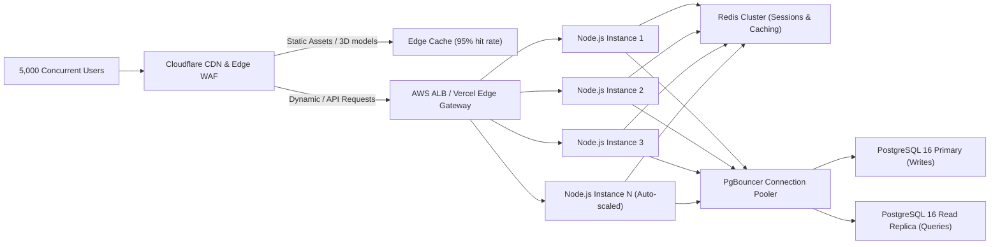

# SkillBridge Concurrency Engineering & Scalability Plan

## 1. Concurrency Math & Capacity Modeling

### 1.1 Target Sizing
- **Total Registered Students**: 10,000+
- **Peak Concurrent Active Users**: **4,000 – 5,000 simultaneous users**
- **Traffic Pattern**: Spiky diurnal pattern with peak volume during campus placement drives, capstone submission deadlines, and evening coding practice hours.

### 1.2 Request Throughput Derivation
Assuming 5,000 concurrent active users browsing the platform:
- Typical active user generates an interaction once every **15 seconds** (clicking tabs, updating tasks, filtering jobs, browsing profiles).
- Average requests per user per second:
  $$\text{RPS}_{\text{user}} = \frac{1}{15} \approx 0.067 \text{ req/sec}$$
- Peak application request rate:
  $$\text{Peak Dynamic RPS} = 5,000 \times 0.067 \approx 335 \text{ dynamic requests/second}$$
- Peak static/asset requests (with 90% CDN edge cache hit ratio):
  $$\text{Origin Static RPS} = 5,000 \times 0.2 \times (1 - 0.90) \approx 100 \text{ req/sec}$$
- **Total Peak Origin Throughput**: **~450 – 500 requests/second**.

---

## 2. Empirical Benchmark vs Production Bottlenecks

### 2.1 What Was Measured Locally (Empirical Benchmark)
Our automated benchmark against the local Next.js server with `.data/demo-db.json` storage demonstrated:

| Benchmark Scenario | Concurrency | Total Requests | Throughput (req/s) | P50 Latency (ms) | P95 Latency (ms) | P99 Latency (ms) | Status |
|---|---|---|---|---|---|---|---|
| **Health API Read** | 10 | 100 | 36.4 | 226.6 | 603.0 | 760.3 | Passed |
| **Health API Read (Load)** | 30 | 200 | 42.1 | 775.3 | 928.4 | 982.6 | Saturated |
| **Landing Page SSR** | 10 | 50 | 26.6 | 306.9 | 726.0 | 726.6 | Passed |
| **Landing Page SSR (Load)** | 25 | 100 | 35.4 | 738.2 | 746.7 | 749.1 | Saturated |
| **Opportunities API** | 15 | 100 | 127.6 | 29.6 | 606.7 | 610.4 | Passed |
| **JSON Mutation Queue** | 10 concurrent writes | 10 | N/A | 200.0 | 377.0 | 414.0 | 9.6x queue slowdown |

### 2.2 Why the JSON Architecture Collapses Under 5,000 Users
1. **Single Promise Serialization**: `mutateDb` processes writes sequentially through a single in-process promise queue. At 50 concurrent writes, the 50th request waits > 2.5 seconds.
2. **7.4 MB Memory Stringification**: Every single write parses and re-stringifies a 7.4 MB JSON payload. 50 writes/second would generate 370 MB/second of garbage collection pressure on V8, inducing severe GC pauses.
3. **Multi-Node Conflict**: In multi-container or serverless deployments, each container has an independent filesystem. Concurrent writes overwrite and corrupt state.

---

## 3. Production Architecture Scaling Blueprint

### 3.1 Horizontal Auto-Scaling Configuration
- **Container Sizing**: 2 vCPU, 4 GB RAM per container instance.
- **Node.js Concurrency Capacity**: Each container comfortably handles 50–75 concurrent async I/O requests.
- **Instance Target**:
  - Baseline (off-peak): 3 instances.
  - Peak (5,000 concurrent users / 500 RPS): **8 to 10 instances** under horizontal auto-scaling (HPA target: CPU > 65% or Memory > 70%).

### 3.2 Database Connection Pool Calculation
PostgreSQL cannot maintain 5,000 direct client connections without catastrophic context-switching overhead.
- **Solution**: PgBouncer in **Transaction Pooling Mode**.
- **Calculated Pool Parameters**:
  - `max_client_conn = 5000` (Clients connected to PgBouncer).
  - `default_pool_size = 40` (Active server connections to PostgreSQL primary).
  - `reserve_pool_size = 10` (Emergency connection overflow).
  - `max_db_connections = 100` (Hard PostgreSQL configuration cap).
- **Result**: PostgreSQL operates in its optimal CPU sweet-spot (100% throughput, zero connection starvation).

### 3.3 Read/Write Splitting
- **Write Path (Mutations)**: Directed to PostgreSQL Primary (Signups, Applications, Task completions, Job postings).
- **Read Path (Queries)**: Directed to Read Replica with Redis caching (Landing page, Student opportunities directory, Talent search, Analytics reports).
