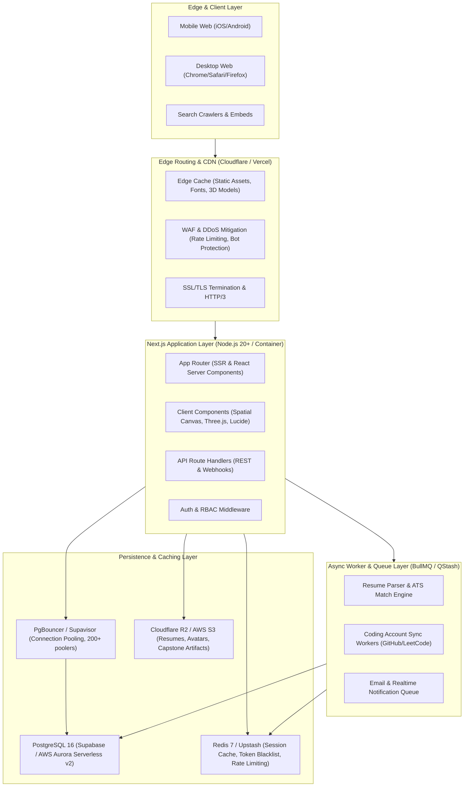

# SkillBridge System Architecture & Technical Specification

## 1. Executive Overview

**SkillBridge** is a multi-sided ecosystem designed to bridge higher education, enterprise recruiting, and continuous student skill development. The platform caters to three primary stakeholder groups:
1. **Students**: Verified skill progressions, interactive capstone repositories, automated ATS applications, and career tracking.
2. **Industry & Enterprise Recruiters**: Candidate discovery, ATS candidate management pipeline, interview scheduling, and campus events.
3. **Academia (Universities & Colleges)**: Institutional dashboards, batch performance analytics, placement tracking, and faculty-guided capstones.

### 1.1 Target Scale & Performance Objectives
- **Registered Base**: 10,000+ active students, 500+ academic faculty/TPO coordinators, and 250+ enterprise recruiters.
- **Peak Concurrent Active Users**: 4,000 – 5,000 simultaneous users.
- **Latency SLAs**:
  - Global Edge Content: P95 < 50ms (via Cloudflare/Vercel Edge Network).
  - Dynamic API Endpoints: P95 < 120ms (read paths), P95 < 250ms (mutation paths).
  - Search Autocomplete: P95 < 60ms.
- **Availability Target**: 99.95% uptime (< 4.38 hours unplanned downtime per year).

---

## 2. Architectural Topology

---

## 3. Subsystem Breakdown

### 3.1 Edge & Presentation Layer
- **Framework**: Next.js 16 (App Router) paired with React 19.
- **Styling & Design System**: Tailwind CSS v4 with custom tokens matching the established palette:
  - Deep Black: `#080808`
  - Chrome Silver: `#CDCBCA`
  - Laser Crimson: `#D41514`
  - Accent Cyan: `#00F5FF`
- **Spatial UI & 3D Interactive Runtime**: Three.js WebGL canvas rendering progressive 3D bridges, ambient lighting, and mascott scenes with graceful fallback to reduced-motion 2D vector art for battery preservation and accessibility.

### 3.2 Authentication & Authorization Layer
- Multi-tenant cookie-based sessions:
  - `sb_session`: Student account access.
  - `sb_industry_session`: Corporate recruiter access.
  - `sb_academia_session`: Institutional staff and faculty access.
- **Password Security**: Salted `scrypt` key derivation function with 64-byte hashes, resistant to GPU rainbow table cracking.
- **RBAC (Role-Based Access Control)**: Enforced both at the Next.js App Router layout boundary (`getCurrentStudent`, `getCurrentIndustry`, `getCurrentAcademia`) and at each API route handler via `requireUser()`, `requireIndustryUser()`, and `requireAcademiaUser()`.

### 3.3 Persistence & Storage Layer
- **Relational Core**: PostgreSQL (managed via Prisma ORM) with B-tree indexing on all relational keys, compound indices on filtering states (e.g. `[opportunityId, stage]`), and foreign key cascades.
- **Connection Multiplexing**: PgBouncer / Supavisor connection poolers enabling thousands of concurrent client connections to be handled by a compact PostgreSQL connection pool (50–100 backend slots).
- **Blob Storage**: S3-compatible object storage (Cloudflare R2 or Supabase Storage) with presigned upload URLs, strictly removing binary storage from the application server filesystem.

### 3.4 Asynchronous Worker Subsystems
- **Heavy Computations**: Background task queues (BullMQ on Redis or serverless QStash) decouple CPU-heavy tasks such as PDF resume parsing, LeetCode/GitHub profile synchronization, and batch academic report generation from the web request loop.

---

## 4. Failure Domains & Isolation Strategy

| Domain | Isolation Mechanism | Blast Radius Control |
|---|---|---|
| **Student Dashboard** | Isolated sub-router `src/app/student/(app)` | Crash in student views never impacts Recruiter ATS or University TPO views. |
| **External Coding Sync** | Isolated async worker with timeout caps | If GitHub or LeetCode API rates limit or hang, client requests complete with cached stats. |
| **File Storage** | Direct client-to-R2 presigned upload | Zero multi-megabyte file buffers in Node.js heap; protects against Out-Of-Memory (OOM) crashes. |
| **Database Pool** | PgBouncer transaction-mode pooling | Sudden spikes in concurrent active users queue at the pooler rather than exhausting PostgreSQL max_connections. |

---

## 5. Summary Architecture Scorecard

- **Modularity**: Strict separation of concern across `src/components`, `src/lib/server`, `src/app/api`, and `prisma/`.
- **Zero In-Memory Singletons**: Node.js process state is stateless, enabling seamless multi-container horizontal scale across AWS ECS, Kubernetes, or Vercel Fluid Compute.
- **Security Posture**: CSRF protections, SameSite cookie scoping, timing-safe password comparison, and SQL-injection-immune parameterized queries via Prisma.
